<a href="https://thaeralkassab.netlify.app/">
  <picture>
    <source media="(prefers-color-scheme: dark)" srcset="assets/header-dark.svg">
    
  </picture>
</a>

I'm an AI/ML engineer at **Convo (Hikaru B.V.)** in the Netherlands. I build customer-facing conversational AI, from AI interview workflows to research-assistant features, along with the LLM workflows and Python backend services behind them. My focus is retrieval-augmented generation, model evaluation and reliable orchestration.

MSc in Computer Science, with published research in explainable AI and graph neural networks.

  <a href="https://thaeralkassab.netlify.app/"><picture><source media="(prefers-color-scheme: dark)" srcset="assets/link-portfolio-dark.svg"></picture></a>&nbsp;
  <a href="https://www.linkedin.com/in/thaeralkassab/"><picture><source media="(prefers-color-scheme: dark)" srcset="assets/link-linkedin-dark.svg"></picture></a>&nbsp;
  <a href="mailto:thaeralkassab1996@gmail.com"><picture><source media="(prefers-color-scheme: dark)" srcset="assets/link-email-dark.svg"></picture></a>

 

<picture>
  <source media="(prefers-color-scheme: dark)" srcset="assets/toolkit-dark.svg">
  
</picture>

  

<picture>
  <source media="(prefers-color-scheme: dark)" srcset="assets/stats-dark.svg">
  
</picture>

  

<picture>
  <source media="(prefers-color-scheme: dark)" srcset="assets/activity-dark.svg">
  
</picture>
<picture>
  <source media="(prefers-color-scheme: dark)" srcset="assets/languages-dark.svg">
  
</picture>

The contribution cards refresh daily from my GitHub contribution calendar. The language mix comes from my own commits over the last 12 months.
